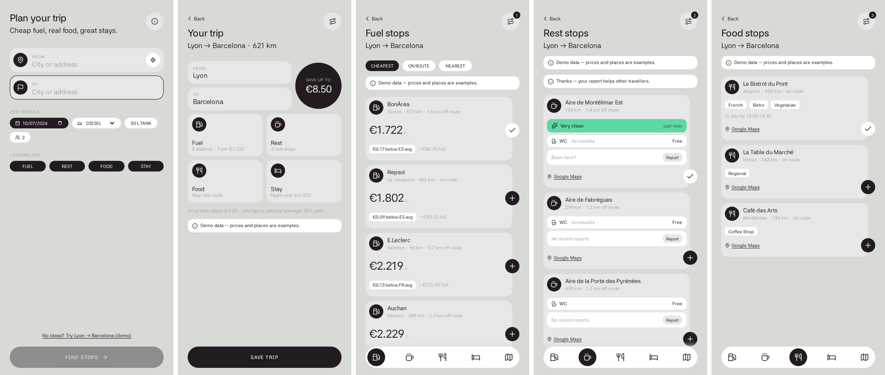
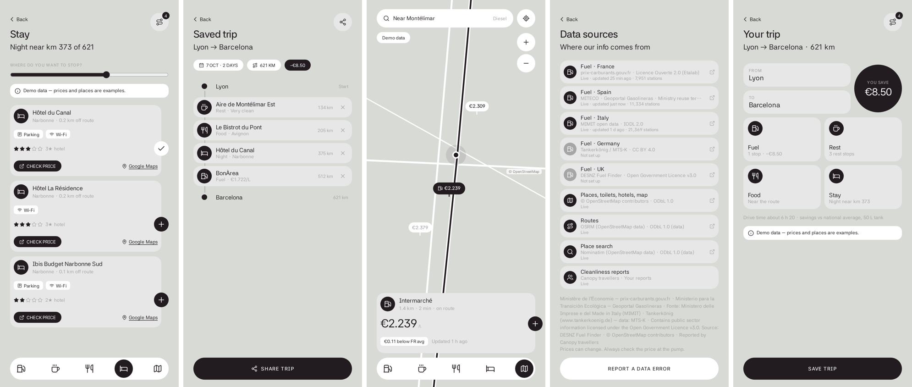

# Canopy — plan smarter, spend less

Road-trip planner that finds the cheapest fuel, rest stops, food and places to stay along your route, using free official open data.

- **Web app / PWA**: React 18 + TypeScript + Vite (installable on a phone home screen)
- **API server**: Node + Express + TypeScript (runs with `tsx`, no build step)
- **Shared types & geo maths** in `shared/`, used by both




## Run it

Requires **Node 22+**.

```bash
npm install
cp .env.example .env      # optional, see below
npm run dev               # API on :8787 + web app on http://localhost:5173
```

Open http://localhost:5173 on your computer, or on your phone (same Wi-Fi) at `http://<your-computer-ip>:5173`.
No route idea? Tap **“Try Lyon → Barcelona (demo)”** on the first screen — demo mode works offline.

Production:

```bash
npm run build             # type-checks, then builds the web app into dist/
npm start                 # one server on :8787 serving the API and the app
```

Other scripts: `npm test` (parsers + geo unit tests), `npm run typecheck`, `npm run check` (all three).

## Deploy to Vercel

1. Push this folder to GitHub (the repo should contain only these files — see *Project layout*).
2. In Vercel: **Add New → Project →** import the repo. Leave the settings as they are (`vercel.json` sets them).
3. Optional: add `CONTACT_EMAIL`, `TANKERKOENIG_API_KEY`, `OVERPASS_URL` etc. under **Settings → Environment Variables**.

How it works: `npm run build` builds the web app, then `scripts/build-vercel.mjs` bundles the Express API into one
serverless function and writes Vercel's [Build Output API](https://vercel.com/docs/build-output-api/v3) folder
(`.vercel/output`). `/api/*` goes to the function, everything else is the app.

Limits on Vercel: each function instance keeps its own cache, so the first request after a cold start downloads the
fuel feeds again (~5–15 s); cleanliness reports are kept in `/tmp` and are lost when an instance is recycled — use a
database (e.g. Vercel Postgres / Neon / Supabase) before launch.

## Screens

| Screen | What it does |
|---|---|
| Trip setup | From / To with place search, date, fuel type, tank size, travellers, stop types |
| Your trip | Route summary, “save up to” fuel saving, category tiles |
| Fuel stops | Live prices along the route, sorted Cheapest / On route / Nearest; badge vs national average; full-tank cost |
| Rest stops | Rest areas & toilets from OpenStreetMap; crowd-reported cleanliness (Very clean / Dirty / Closed) |
| Food stops | Cafés & restaurants near the route |
| Stay | Hotels near your overnight stop (slider), “Check price” link, Google Maps link |
| Saved trip | Your stops in route order, total saving, share |
| Map | Your location, the route, nearby fuel prices as pins, closest cheap station |
| Data sources | Every source, its licence and live status (required credits) |

## Data sources (all free)

| Data | Source | Licence | Notes |
|---|---|---|---|
| Fuel · France | prix-carburants.gouv.fr | Licence Ouverte 2.0 | Feed has no station names — added from OpenStreetMap |
| Fuel · Spain | MITECO REST service | Ministry reuse terms | |
| Fuel · Italy | MIMIT open data | IODL 2.0 | Daily, prices as at 08:00 |
| Fuel · Germany | Tankerkönig | CC BY 4.0 | Needs `TANKERKOENIG_API_KEY`; map “nearby” only (API limits) |
| Fuel · UK | DESNZ Fuel Finder | OGL v3 | **Not implemented yet** — see `server/providers/uk.ts` |
| Places, roads | OpenStreetMap via Overpass | ODbL | |
| Routes | OSRM | ODbL (data) | |
| Place search | Nominatim | ODbL (data) | |
| Cleanliness | Canopy users | — | Stored in `server/data/reports.json` |

“Below average” badges compare against the **national average computed from each country’s full official feed** (all stations, prices updated in the last 8 days).

## Before going live

- **Self-host OSM services.** The public Overpass, OSRM and Nominatim servers are for light use only and are often busy (you’ll see “still loading” notices). Point `OVERPASS_URL`, `OSRM_URL` and `NOMINATIM_URL` at your own instances or a commercial provider.
- **Set `CONTACT_EMAIL`** in `.env` — Nominatim/Overpass ask apps to identify themselves. Placeholder addresses (example.com) are rejected.
- **Replace the JSON reports file** with a database, and add proper abuse protection.
- **UK Fuel Finder** needs developer-portal credentials and the endpoint details from that portal.
- **Have the licence terms reviewed** (Tankerkönig’s and OSM’s share-alike in particular). Credits are shown on the Data sources screen.

## Project layout

```
server/
  app.ts              Express API: /api/route, /api/fuel, /api/fuel/nearby, /api/places, /api/reports, /api/sources
  index.ts            local / production Node server (serves dist/ too)
  vercel.ts           Vercel function entry
  providers/          france.ts, spain.ts, italy.ts, germany.ts, uk.ts (+ registry, caching, status)
  osm.ts              Overpass queries (rest areas, food, hotels, roads, station names)
  routing.ts          OSRM routing + Nominatim search
  reports.ts          crowd cleanliness reports
  sources.ts          licences & credits
shared/
  types.ts  geo.ts  demo.ts
src/
  screens/            one file per screen
  components/ui.tsx   cards, pills, nav bar, notices
  lib/                api client, store (localStorage), router, formatting
tests/                vitest
scripts/build-vercel.mjs  Vercel packaging
vercel.json
```
